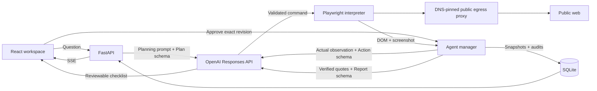

# BrowsePilot

For the temporary GitHub Pages + Cloud Run university demo, use [DEPLOYMENT.md](DEPLOYMENT.md): opt-in Pages automation, Secret Manager configuration, exact deployment commands, temporary storage, costs, and teardown. The existing local and standalone Docker instructions below remain available.

### Research, with direction.

BrowsePilot is a public-web research assistant for **CS4680: Prompt Engineering**: describe a question, review an AI-generated checklist, approve it, and watch a real server-side Chromium browser collect evidence for a cited report.

Repetitive research means opening pages, comparing claims, tracking sources, and noticing gaps; BrowsePilot consolidates that work into a transparent workspace with explicit approval and a durable audit trail.


## Features

- Reviewable AI checklist, editable requests, plan regeneration, and revision-bound approval
- Real Observe → Decide → Act → Observe loop using OpenAI Responses structured outputs
- Isolated server-side Chromium, live screenshots, current URL, SSE progress, elapsed time, and cancellation
- Verbatim quote validation, original source URLs, cited findings, comparisons, and explicit information gaps
- Markdown copy/download, SQLite research history, and persistent action audits
- Responsive Cyber Glacier design, local fonts, licensed glacier photography, keyboard support, and reduced motion
- Runtime, action, API call, token, and concurrency limits; public-address and read-only request enforcement
- Shared-workspace password and one Docker container serving both React and FastAPI

There is no mock research mode, pre-populated success data, or frontend API key.

## Stack

| Layer | Implementation |
| --- | --- |
| Frontend | React 19, TypeScript, Vite, Tailwind CSS 4, Lucide React, Framer Motion |
| Backend | Python 3.11+, FastAPI, Uvicorn, Pydantic |
| AI | OpenAI Python SDK and Responses API |
| Browser | Playwright and headless Chromium |
| Persistence | SQLite WAL, JSON session snapshots, append-only audit events |
| Live updates | SSE full snapshots, automatic reconnection, heartbeat comments |
| Deployment | Multi-stage Dockerfile, Compose, persistent volume |

## Quick start: Docker

Prerequisites: Docker Engine/Desktop running Linux containers and an OpenAI API key with available API credits; a ChatGPT subscription does not substitute for API billing.

1. Copy `.env.example` to `.env` and set `OPENAI_API_KEY`.
2. Start Docker and run the following commands from the repository.
3. Open [http://localhost:8000](http://localhost:8000), submit a question, review the plan, and select **Start research**.

```sh
# Build the frontend and install Python plus Chromium inside the container.
docker compose up --build -d

# Inspect application startup and research errors.
docker compose logs -f browsepilot
```

Compose binds to loopback by default; deployed users need only a normal web browser, with no local Python, Node, Playwright, Chrome, or Edge installation.

```sh
# Stop the service while retaining research in the named volume.
docker compose down
```

Do not add `--volumes` unless you intend to erase research data.

## Local development

Developers need Python 3.11+ and Node 22 (the Docker build version).

### Windows PowerShell

```powershell
# Prepare isolated backend dependencies and the server-side browser.
python -m venv .venv
.\.venv\Scripts\python.exe -m pip install -r requirements.txt
.\.venv\Scripts\python.exe -m playwright install chromium
Copy-Item .env.example .env
# Edit .env and set OPENAI_API_KEY.

# Build and serve the React frontend from FastAPI.
npm ci --prefix frontend
npm run build --prefix frontend
.\.venv\Scripts\python.exe -m backend.run
```

### macOS / Linux

```sh
# Prepare backend dependencies and Chromium, including required system packages.
python3 -m venv .venv
. .venv/bin/activate
pip install -r requirements.txt
python -m playwright install --with-deps chromium
cp .env.example .env
# Edit .env and set OPENAI_API_KEY.

# Build and serve the application.
npm ci --prefix frontend
npm run build --prefix frontend
uvicorn backend.main:app --host 127.0.0.1 --port 8000 --workers 1
```

For frontend hot reload, run `npm run dev --prefix frontend` in another terminal and open [http://127.0.0.1:5173](http://127.0.0.1:5173); Vite proxies `/api` to port 8000.

On Windows, use `python -m backend.run` from the repository root (with the virtual environment's Python as shown above); optional `--host` and `--port` arguments are supported. The launcher creates a top-level Proactor event loop before starting FastAPI and calls Uvicorn's asynchronous server on that loop, without nested loops or request-time policy changes. Restart the backend manually after Python edits; this launcher deliberately does not accept `--reload` or `--workers`.

The pinned Uvicorn version selects a Selector loop on Windows when reload or multiple workers enable its subprocess supervisor. Windows Selector loops cannot run the subprocess transport required by Playwright, while Proactor loops can ([Python asyncio platform documentation](https://docs.python.org/3/library/asyncio-platforms.html)). `WindowsSelectorEventLoopPolicy` likewise creates incompatible loops; setting `WindowsProactorEventLoopPolicy` inside an already-running FastAPI app cannot replace its active loop, and Uvicorn's explicit loop factory can override policy-based defaults. The dedicated launcher avoids both issues; Linux and Docker keep their existing startup commands. This fix was implemented by source inspection only, without tests or runtime verification.

## Environment variables

Cloud Run's dedicated Docker target explicitly sets `BROWSEPILOT_ENV_FILE=/secrets/browsepilot/env` to select a Secret Manager dotenv mount instead of the default project `.env`; it still never falls back to a process `OPENAI_API_KEY`. This deployment-specific override is described in [DEPLOYMENT.md](DEPLOYMENT.md).

`OPENAI_API_KEY` is read **only from the `.env` file in the project root**, resolved relative to `backend/config.py`; system, terminal, and IDE environment keys cannot override it. Enter the literal key, not a `${VARIABLE}` reference; missing or blank values disable planning instead of falling back to another credential. Restart the backend after changing `.env`; startup logs show the credential file path and whether a key is configured, never the key itself. Other settings retain normal environment-variable precedence; all secrets remain on the server.

Docker Compose mounts `.env` read-only at `/app/.env`; keep it readable by container UID 10001 and never bake it into the image. For other container hosts, mount a secret file at `/app/.env` containing `OPENAI_API_KEY=...`; an environment-only API key is intentionally ignored. A correct key can still receive HTTP 429 for account quota or rate limits; changing the credential source does not itself resolve those account limits.

| Variable | Default | Purpose |
| --- | --- | --- |
| `OPENAI_API_KEY` | empty | Required for planning and execution |
| `OPENAI_MODEL` | `gpt-4.1-mini` | Accessible model supporting Responses structured outputs |
| `APP_ENV` | `development` | Production requires a password of at least 16 characters |
| `ACCESS_PASSWORD` | empty | Shared workspace access gate |
| `COOKIE_SECURE` | `false` | Set true for deployed HTTPS |
| `ALLOWED_ORIGINS` | empty | Exact comma-separated browser origins when required behind a proxy |
| `MAX_STEPS` | `18` | Browser action limit |
| `MAX_RUNTIME_SECONDS` | `240` | Startup, browsing, extraction, and synthesis deadline |
| `MAX_CONCURRENT_SESSIONS` | `2` | Combined planning/execution job capacity |
| `MAX_SESSION_TOKENS` | `60000` | Conservative allowance including regeneration and retries |
| `MAX_MODEL_CALLS` | `32` | Request attempts, including retries |
| `API_TIMEOUT_SECONDS` | `35` | One OpenAI request timeout |
| `SEARCH_PROVIDERS` | `bing,duckduckgo,google` | Ordered public search providers; comma-separated subset of these names |
| `DATA_DIR` | `data` | SQLite/screenshots; `/app/data` in Docker |
| `FRONTEND_DIR` | `frontend/dist` | Built frontend path |
| `PORT` | `8000` in Docker | Container HTTP listener |

Before each model call, a conservative input/schema/output token allowance is reserved; actual usage replaces it after a successful response, while failed-call estimates remain reserved. This can stop a session early and is not a dollar-denominated spending cap; configure project billing controls separately.

### Research reliability and efficiency

Explicit HTTP(S) URLs in the approved request are opened before searching. Accessible source pages automatically receive READ_PAGE and EXTRACT, with exact whitespace-normalized quote verification before more navigation; a simple answerable page normally follows NAVIGATE → READ_PAGE → EXTRACT → DONE, followed by synthesis. This is the intended path, not a measured action-count guarantee.

`SEARCH_PROVIDERS` controls fallback order without additional API keys. A normalized query tries each permitted provider once; empty results or blocked searches move to the next provider, and access-denied/challenge domains are excluded for that run. Equivalent visited URLs, tracking variants, repeated queries, unchanged reads/extractions, and no-progress loops are bounded. A 404 prevents retrying that URL; two ordinary navigation failures exhaust its host. Public search availability depends on the provider and network: there is no CAPTCHA solving, stealth, or guaranteed accessible search engine.

DOM observations exclude scripts, navigation, forms, hidden text, and repeated boilerplate. Extraction receives at most 6,000 characters; action decisions receive a 1,400-character preview and at most 20 links, with repeated text replaced by an unchanged marker. History is limited to five actions, quotes to 600 characters each, and report evidence is selected across sources within a bounded UTF-8 context. Japanese and other languages are retained; generated findings follow the requested language and preserve numerical units and qualifications.

The existing session budgets are unchanged. Phase-specific output limits, two-attempt bounded retries, deterministic direct-page decisions, and evidence-based early stopping reduce model work. Browsing and extraction reserve one request plus estimated tokens for the final report, including space for new passages. Reported input/output usage stays separate from conservative reservations for calls without usage data; see the [OpenAI token accounting guide](https://developers.openai.com/api/docs/guides/token-counting).

Checklist criteria are assessed against verified passages and cited report evidence; one blocked website does not fail a high-level objective. Completed research requires substantive cited findings, model-assessed coverage of the requested goal, verified requested sources, and no reported information gaps. Partial research retains useful evidence with gaps; no verified evidence means a failed session. A synthesis failure produces a deterministic partial quotation report with original source links, without claiming those original-language quotes were translated or summarized.

Audit events record action reasons, provider fallback, sanitized failures, evidence counts, model usage, and stopping reasons. Semantic relevance, translation, and claim entailment remain model judgments; exact quote matching proves provenance, not correctness of every interpretation. Long pages and large comparisons may exceed the bounded evidence context, and source URLs may later change. These reliability changes were reviewed from source only: no tests, application launch, browser execution, or runtime verification were performed.

## Architecture



### How the LLM generates actionable commands

`responses.create(..., text={"format": {"type": "json_schema", ...}})` requests a strict Pydantic-derived schema; reported token usage is recorded before `Action.model_validate_json(...)` validates the output, including when parsing fails. Semantic validation precedes an explicit Python `match` branch and another browser observation. The model cannot execute code or choose arbitrary selectors; `CLICK` follows a numbered observed anchor through the same safe navigation checks.

Illustrative command, not a prerecorded result:

```json
{
  "command": "NAVIGATE", "reason": "Open the official Python overview", "step": 1,
  "url": "https://www.python.org/about/", "query": null, "link_id": null,
  "tab_id": null, "direction": null, "seconds": null, "updates": []
}
```

The complete vocabulary is in [docs/ACTIONS.md](docs/ACTIONS.md).

### Prompt engineering and evidence

Four templates in `backend/prompts.py` cover planning, action selection, extraction, and reporting; each separates the approved research goal from untrusted webpage data. They constrain the vocabulary, prefer original sources, require short public action explanations, and preserve uncertainty.

Extraction quotes must match actual browser text after whitespace normalization; the server stamps the source URL, title, timestamp, and evidence ID. Every factual report statement carries evidence references, and unknown references trigger a partial quotation report. Exact matching establishes provenance, not semantic proof that the generated summary correctly interprets every source.

JSON schema, Pydantic validation, bounded retries with exponential backoff, request timeouts, and usage accounting enforce the model interface; see the [official Structured Outputs guide](https://developers.openai.com/api/docs/guides/structured-outputs?api-mode=responses).

## Project layout

```text
backend/
  main.py         API, access gate, SSE, static serving
  agent.py        planning, execution, extraction, synthesis, exports
  browser.py      isolated Chromium and action interpreter
  safety.py       URL validation and DNS-pinned egress proxy
  models.py       Pydantic contracts
  prompts.py      phase-specific prompts
  llm.py          Responses client, retries, budgets, usage
  storage.py      SQLite snapshots and audits
  config.py       environment settings
frontend/
  src/            React workspace, typed client, Cyber Glacier styles
  public/         photograph and dependency license notices
docs/             command reference and real screenshots
Dockerfile
docker-compose.yml
ASSET_CREDITS.md
DEMO_GUIDE.md
VERIFICATION.md
```

## API

| Endpoint | Behavior |
| --- | --- |
| `GET /api/health` | Minimal health probe |
| `GET /api/auth`; `POST /api/login`, `/api/logout` | Access status and signed HttpOnly session cookies |
| `GET /api/config` | Non-secret settings |
| `GET /api/sessions`; `POST /api/sessions` | Latest 50 sessions; create a research plan |
| `GET /api/sessions/{id}` | Complete saved state and audit events |
| `POST /api/sessions/{id}/regenerate` | Invalidate the old plan revision and regenerate |
| `POST /api/sessions/{id}/approve` | Start exactly the displayed revision |
| `POST /api/sessions/{id}/stop` | Cancel work and close its browser |
| `GET /api/sessions/{id}/events` | Reconnectable full-state SSE snapshots |
| `GET /api/sessions/{id}/screenshot` | Latest authenticated browser JPEG |
| `GET /api/sessions/{id}/report.md` | Saved report Markdown |

Older sessions remain accessible by ID; SQLite retains complete history.

## Cloud deployment

Use a Docker-capable **long-running host with persistent storage and unprivileged user namespaces**; a [DigitalOcean Docker Droplet](https://docs.digitalocean.com/products/marketplace/catalog/docker/) is one option that provides Docker and Compose. Static hosts and short-lived functions are insufficient for Chromium and SQLite.

1. Create a Docker-capable Linux VM with at least 2 GB RAM, SSH into it, and clone this repository.
2. Copy `.env.example` to `.env`, restrict that file to the administrator, and set `OPENAI_API_KEY`, `OPENAI_MODEL`, `APP_ENV=production`, and a unique `ACCESS_PASSWORD` of at least 16 characters.
3. Set `COOKIE_SECURE=true` and `ALLOWED_ORIGINS=https://YOUR-DOMAIN` to the exact HTTPS browser origin.
4. Run `docker compose up --build -d`; Compose installs the sandbox seccomp profile and mounts persistent storage at `/app/data`, owned by UID/GID 10001.
5. Point a DNS name to the VM, configure an HTTPS reverse proxy on the host to forward to `127.0.0.1:8000`, and restrict inbound traffic to HTTPS and administrative SSH.
6. Use `/api/health` as the health probe; disable proxy buffering for SSE, allow response streams longer than the research deadline, and retain **one application instance with one Uvicorn worker**.
7. Run the focused example in [DEMO_GUIDE.md](DEMO_GUIDE.md) and verify its citations before presenting; back up the named Docker data volume.

Trust forwarded headers only from the actual proxy addresses using `FORWARDED_ALLOW_IPS`; the explicit allowed origin also supports HTTPS termination without trusting arbitrary forwarded headers. Managed container providers must support the sandbox namespace/profile requirements in [security/README.md](security/README.md). No public deployment is claimed.

## Security and limitations

- This is a **single shared workspace**, not separate accounts: password holders can view and stop every session; use HTTPS and never expose unprotected development mode.
- Each session has a fresh browser without saved credentials, permissions, downloads, writable form tools, or automatic login; cleanup runs on cancellation and shutdown.
- Requests are restricted to GET/HEAD and public HTTP(S) standard ports; service workers, WebSockets, and unnecessary resource types are blocked.
- The egress proxy validates every DNS answer and connects to a vetted numeric IP, preventing a second browser-side DNS resolution; localhost, private, reserved, link-local, metadata, and unsafe-scheme destinations are blocked.
- Suspected mutation paths are rejected, but GET requests are not universally side-effect-free; path filtering is a conservative heuristic, not a universal semantic guarantee.
- Untrusted content cannot grant new runtime tools; prompt injection still requires care, and a production egress firewall should independently block internal networks and metadata services against browser-engine compromise.
- Cookies are signed, HttpOnly, SameSite, and expire after eight hours; origin checks, sign-in throttling, CSP, and non-cacheable APIs provide additional protection.
- Queries and retrieved text are sent to OpenAI; do not enter confidential requests or embed credentials in URLs.
- SQLite retains prompts, evidence, reports, actions, errors, timestamps, and the latest screenshot per session; configure retention and backups for your deployment.
- Active work is interrupted on restart and marked failed; it does not automatically resume or consume new credits.
- Only public HTML/plain-text sites are supported; PDFs, complex application controls, authenticated pages, CAPTCHA/MFA bypass, payments, and account changes are excluded.
- Search engines may block automation; accessible official URLs make demonstrations more reliable.
- Screenshots update after actions rather than continuously; text/link observations are bounded, longer pages use a scrolling text window, and at most 48 verified passages are retained per session.
- Checklist progress is model-assessed and citations require human review; unavailable synthesis produces a partial report of real collected quotations when possible.
- Individual runtime/cost limits are not an organization-wide billing quota or an anonymous multiuser service.

No unit tests are included, as requested; [VERIFICATION.md](VERIFICATION.md) records manual checks and remaining limits.

## CS4680 alignment

| Criterion | Weight | Demonstration |
| --- | --- | --- |
| Problem Identification | 10% | Repetitive browsing, comparisons, and source tracking |
| Design and Implementation | 30% | OpenAI, structured interpreter, Playwright, FastAPI, SQLite, SSE, React |
| Prompt Engineering | 20% | Four prompts, constrained JSON, observation feedback, validation, evidence grounding |
| UI/UX | 10% | Cyber Glacier visual design, approval flow, live progress, accessible responsive controls |
| Presentation and Live Demo | 30% | Repeatable focused walkthrough in [DEMO_GUIDE.md](DEMO_GUIDE.md) |

## License

Code follows the repository's [Apache 2.0 license](LICENSE); fonts, icons, and photography retain their respective licenses in [ASSET_CREDITS.md](ASSET_CREDITS.md).
