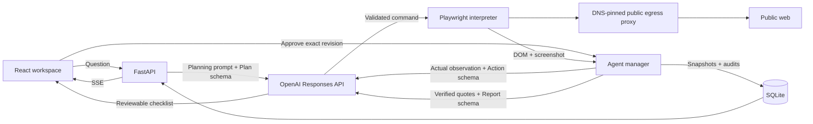

# BrowsePilot

For the temporary GitHub Pages + Cloud Run university demo, use [DEPLOYMENT.md](DEPLOYMENT.md): opt-in Pages automation, Secret Manager configuration, exact deployment commands, temporary storage, costs, and teardown. The existing local and standalone Docker instructions below remain available.

### Research, with direction.

BrowsePilot is a public-web research assistant for **CS4680: Prompt Engineering**: describe a question, review an AI-generated checklist, approve it, and watch a real server-side Chromium browser collect evidence for a cited report.

Repetitive research means opening pages, comparing claims, tracking sources, and noticing gaps; BrowsePilot consolidates that work into a transparent workspace with explicit approval and a durable audit trail.


## Features

- Reviewable AI checklist, editable requests, plan regeneration, and revision-bound approval
- Real Observe → Decide → Act → Observe loop using OpenAI Responses structured outputs
- Isolated server-side Chromium, live screenshots, current URL, SSE progress, elapsed time, and cancellation
- Verbatim quote validation, original source URLs, cited findings, comparisons, and explicit information gaps
- Markdown copy/download, SQLite research history, and persistent action audits
- Responsive Cyber Glacier design, local fonts, licensed glacier photography, keyboard support, and reduced motion
- Runtime, action, API call, token, and concurrency limits; public-address and read-only request enforcement
- Shared-workspace password and one Docker container serving both React and FastAPI

There is no mock research mode, pre-populated success data, or frontend API key.

## Stack

| Layer | Implementation |
| --- | --- |
| Frontend | React 19, TypeScript, Vite, Tailwind CSS 4, Lucide React, Framer Motion |
| Backend | Python 3.11+, FastAPI, Uvicorn, Pydantic |
| AI | OpenAI Python SDK and Responses API |
| Browser | Playwright and headless Chromium |
| Persistence | SQLite WAL, JSON session snapshots, append-only audit events |
| Live updates | SSE full snapshots, automatic reconnection, heartbeat comments |
| Deployment | Multi-stage Dockerfile, Compose, persistent volume |

### Research reliability and efficiency

Explicit HTTP(S) URLs in the approved request are opened before searching. Accessible source pages automatically receive READ_PAGE and EXTRACT, with exact whitespace-normalized quote verification before more navigation; a simple answerable page normally follows NAVIGATE → READ_PAGE → EXTRACT → DONE, followed by synthesis. This is the intended path, not a measured action-count guarantee.

`SEARCH_PROVIDERS` controls fallback order without additional API keys. A normalized query tries each permitted provider once; empty results or blocked searches move to the next provider, and access-denied/challenge domains are excluded for that run. Equivalent visited URLs, tracking variants, repeated queries, unchanged reads/extractions, and no-progress loops are bounded. A 404 prevents retrying that URL; two ordinary navigation failures exhaust its host. Public search availability depends on the provider and network: there is no CAPTCHA solving, stealth, or guaranteed accessible search engine.

DOM observations exclude scripts, navigation, forms, hidden text, and repeated boilerplate. Extraction receives at most 6,000 characters; action decisions receive a 1,400-character preview and at most 20 links, with repeated text replaced by an unchanged marker. History is limited to five actions, quotes to 600 characters each, and report evidence is selected across sources within a bounded UTF-8 context. Japanese and other languages are retained; generated findings follow the requested language and preserve numerical units and qualifications.

The existing session budgets are unchanged. Phase-specific output limits, two-attempt bounded retries, deterministic direct-page decisions, and evidence-based early stopping reduce model work. Browsing and extraction reserve one request plus estimated tokens for the final report, including space for new passages. Reported input/output usage stays separate from conservative reservations for calls without usage data; see the [OpenAI token accounting guide](https://developers.openai.com/api/docs/guides/token-counting).

Checklist criteria are assessed against verified passages and cited report evidence; one blocked website does not fail a high-level objective. Completed research requires substantive cited findings, model-assessed coverage of the requested goal, verified requested sources, and no reported information gaps. Partial research retains useful evidence with gaps; no verified evidence means a failed session. A synthesis failure produces a deterministic partial quotation report with original source links, without claiming those original-language quotes were translated or summarized.

Audit events record action reasons, provider fallback, sanitized failures, evidence counts, model usage, and stopping reasons. Semantic relevance, translation, and claim entailment remain model judgments; exact quote matching proves provenance, not correctness of every interpretation. Long pages and large comparisons may exceed the bounded evidence context, and source URLs may later change. These reliability changes were reviewed from source only: no tests, application launch, browser execution, or runtime verification were performed.

## Architecture



### How the LLM generates actionable commands

`responses.create(..., text={"format": {"type": "json_schema", ...}})` requests a strict Pydantic-derived schema; reported token usage is recorded before `Action.model_validate_json(...)` validates the output, including when parsing fails. Semantic validation precedes an explicit Python `match` branch and another browser observation. The model cannot execute code or choose arbitrary selectors; `CLICK` follows a numbered observed anchor through the same safe navigation checks.

Illustrative command, not a prerecorded result:

```json
{
  "command": "NAVIGATE", "reason": "Open the official Python overview", "step": 1,
  "url": "https://www.python.org/about/", "query": null, "link_id": null,
  "tab_id": null, "direction": null, "seconds": null, "updates": []
}
```

The complete vocabulary is in [docs/ACTIONS.md](docs/ACTIONS.md).

### Prompt engineering 

Four templates in `backend/prompts.py` cover planning, action selection, extraction, and reporting; each separates the approved research goal from untrusted webpage data. They constrain the vocabulary, prefer original sources, require short public action explanations, and preserve uncertainty.

Extraction quotes must match actual browser text after whitespace normalization; the server stamps the source URL, title, timestamp, and evidence ID. Every factual report statement carries evidence references, and unknown references trigger a partial quotation report. Exact matching establishes provenance, not semantic proof that the generated summary correctly interprets every source.

JSON schema, Pydantic validation, bounded retries with exponential backoff, request timeouts, and usage accounting enforce the model interface; see the [official Structured Outputs guide](https://developers.openai.com/api/docs/guides/structured-outputs?api-mode=responses).

## Project layout

```text
backend/
  main.py         API, access gate, SSE, static serving
  agent.py        planning, execution, extraction, synthesis, exports
  browser.py      isolated Chromium and action interpreter
  safety.py       URL validation and DNS-pinned egress proxy
  models.py       Pydantic contracts
  prompts.py      phase-specific prompts
  llm.py          Responses client, retries, budgets, usage
  storage.py      SQLite snapshots and audits
  config.py       environment settings
frontend/
  src/            React workspace, typed client, Cyber Glacier styles
  public/         photograph and dependency license notices
docs/             command reference and real screenshots
Dockerfile
docker-compose.yml
ASSET_CREDITS.md
DEMO_GUIDE.md
VERIFICATION.md
```

## API

| Endpoint | Behavior |
| --- | --- |
| `GET /api/health` | Minimal health probe |
| `GET /api/auth`; `POST /api/login`, `/api/logout` | Access status and signed HttpOnly session cookies |
| `GET /api/config` | Non-secret settings |
| `GET /api/sessions`; `POST /api/sessions` | Latest 50 sessions; create a research plan |
| `GET /api/sessions/{id}` | Complete saved state and audit events |
| `POST /api/sessions/{id}/regenerate` | Invalidate the old plan revision and regenerate |
| `POST /api/sessions/{id}/approve` | Start exactly the displayed revision |
| `POST /api/sessions/{id}/stop` | Cancel work and close its browser |
| `GET /api/sessions/{id}/events` | Reconnectable full-state SSE snapshots |
| `GET /api/sessions/{id}/screenshot` | Latest authenticated browser JPEG |
| `GET /api/sessions/{id}/report.md` | Saved report Markdown |

Older sessions remain accessible by ID; SQLite retains complete history.

## License

Code follows the repository's [Apache 2.0 license](LICENSE); fonts, icons, and photography retain their respective licenses in [ASSET_CREDITS.md](ASSET_CREDITS.md).
