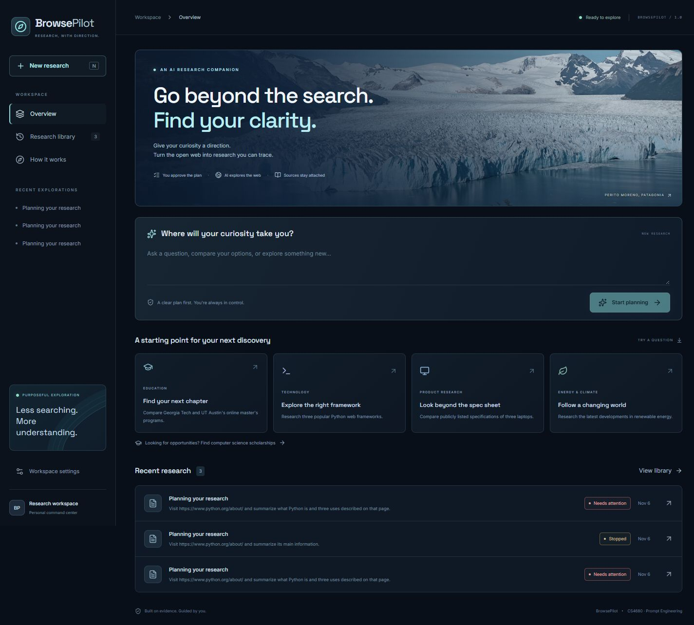
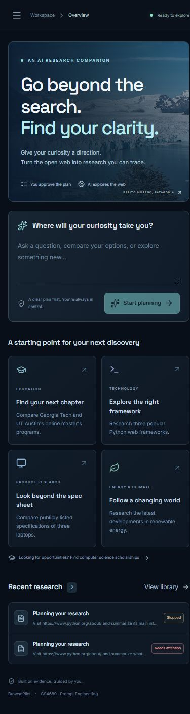
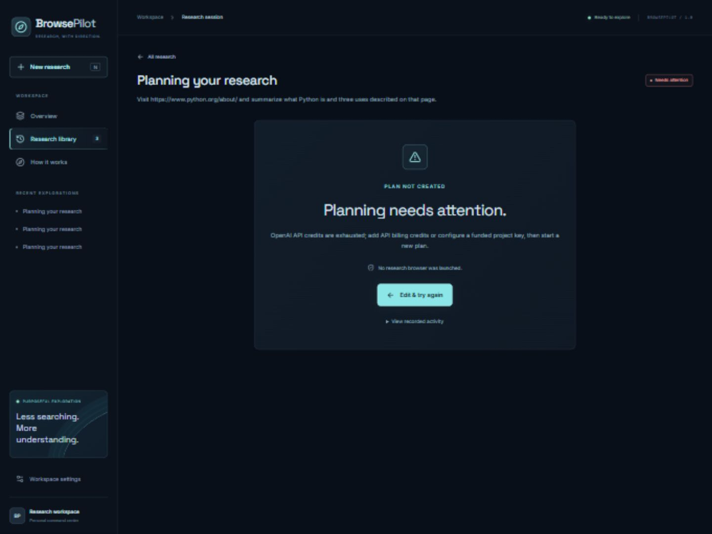

# Manual verification

Verified on November 6, 2026 using Windows, Python 3.13, Node 20.19, and the production Vite build served by FastAPI; no unit-test files were created.

## Passed

| Area | Observed result |
| --- | --- |
| Frontend build | TypeScript compilation and production Vite build completed successfully |
| Dependency installation | Python dependencies installed; npm audit reported zero vulnerabilities |
| Backend import/compilation | All backend modules compiled; the app served HTTP successfully |
| Structured-output contracts | Planning, action, extraction, and report schemas converted to strict OpenAI JSON schemas; the SDK exposes Responses parsing |
| API/static serving | `/api/health` and the built application returned HTTP 200 |
| Real browser | Chromium opened `https://www.python.org/about/`, read the actual title/text/anchors, and captured a real JPEG |
| Browser commands | NAVIGATE, observed-anchor CLICK, BACK, SCROLL, READ_PAGE, NEW_TAB, SWITCH_TAB, WAIT, and DONE executed against public pages |
| Browser cleanup | Browser and proxy closed; zero tracked proxy connections remained |
| URL restrictions | Localhost, loopback, private IP, cloud metadata, and file URLs were rejected |
| DNS boundary | Direct proxy DNS resolution of loopback was rejected |
| Approval gate | Attempting approval before a valid plan existed returned HTTP 409; browser action count stayed zero |
| Cancellation | A real in-flight planning request was cancelled and persisted as stopped |
| SSE | Events returned `text/event-stream` with the persisted cancelled state and audit log |
| Persistence | Sessions reopened through the API and UI; records remained after a backend restart |
| Export preconditions | Requesting a report before one exists returned HTTP 409 |
| Origin checks | A foreign-origin research submission returned HTTP 403 |
| Access gate | Anonymous access and incorrect password returned 401; valid sign-in issued an HttpOnly cookie and allowed access; logout restored 401 |
| Desktop/mobile UI | Actual 1440-pixel and 390-pixel layouts inspected; mobile document width matched its viewport without horizontal overflow |
| Navigation | Example prompt entry, planning submission, mobile drawer, research library, and reopening saved failures exercised |
| Compose configuration | Docker Compose parsed the service configuration successfully without printing secrets |
| Real API failure handling | OpenAI returned HTTP 429 with `credit_balance_exhausted` / `insufficient_quota`; the app now displays a billing-specific error and stops after one attempt |

## Blocked or not verified end-to-end

- **Complete AI-driven research:** the environment's OpenAI API project has exhausted credits, so successful AI planning, approved autonomous action selection, model extraction, and final AI synthesis could not be verified together.
- **Report interaction success path:** copy/download and citation controls are implemented, but no artificial successful session or fabricated report was inserted to pretend this path passed.
- **Temporary model failures and prompt injection:** bounded retries and runtime protections are implemented, but exhaustive adversarial or transient-error testing was not performed.
- **Public search reliability:** the SEARCH command reached Google's access-challenge page; independent Bing and DuckDuckGo HTML checks returned no results and HTTP 403 respectively in this environment. No CAPTCHA was solved or bypassed; use direct official URLs for the initial demo and expect gaps when search providers restrict automation.
- **Docker build/runtime:** Docker Desktop is installed, but its engine did not respond after startup or a bounded 15-second probe; the image was not built or run here.
- **Public deployment:** none was attempted or claimed.

Final dependency rechecks passed with FastAPI 0.162.0, Uvicorn 0.54.0, OpenAI 3.46.0, Pydantic Settings 2.16.2, and Playwright 1.64.1; `pip check`, strict schema conversion, backend compilation, and the final frontend production build passed. Chromium 156.0.8078.4 launched with the sandbox explicitly enabled, navigated to the official Python page, captured a JPEG, and cleaned up its proxy connections. The upgraded backend retained saved session/error data and passed health, static-serving, and origin checks.

## Actual screenshots

## Finish the acceptance run

1. Fund the OpenAI API project or set `OPENAI_API_KEY` to a funded project key on the server.
2. Start a responsive Docker engine, copy `.env.example` to `.env`, and run `docker compose up --build -d`.
3. Use the focused Python request in [DEMO_GUIDE.md](DEMO_GUIDE.md), review the checklist, and select Start research.
4. Verify actual screenshots and source URLs, confirm the report's claims against its quoted passages, and exercise Copy Report and Download Markdown.
5. Reopen the completed session after a container restart to confirm persistent storage in the deployment environment.
